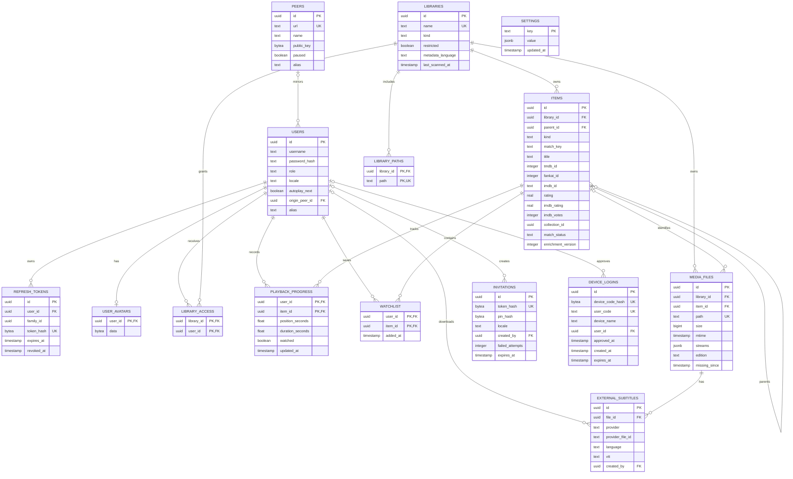

# Database Schema

Plys stores its application data in PostgreSQL. The schema is defined by the Goose migrations in [`api/db/migrations`](../api/db/migrations) and queried through sqlc.

## Entity Relationship Diagram

`PK` means primary key, `FK` means foreign key, and `UK` means a unique key or index.

## Tables

### `users`

Stores local accounts and shadow accounts mirrored from paired servers. A local username is unique among local users, while a federated username is unique within its origin peer. The `role` controls administration rights, `autoplay_next` stores the playback preference, and `alias` changes the displayed name. Deleting a peer cascades to all of its shadow users.

### `refresh_tokens`

Stores hashed refresh-token families for persistent authentication. Each token belongs to one user and has a device name, expiry time, and optional revocation time. Tokens are rotated in families so reuse of an older token can invalidate related sessions.

### `settings`

A small key-value store for server-wide configuration. Values are kept as JSON so settings can evolve independently of schema migrations. Examples include API credentials and metadata preferences.

### `libraries`

Defines a media library, its type (`movies`, `series`, or `other`), and its scan metadata. Libraries are restricted by default; administrators see every library, while regular users require a matching `library_access` row. `metadata_language` overrides the server-wide metadata language.

### `library_paths`

Maps a library to one or more resolved filesystem paths. A path can belong to only one library, and deleting a library deletes all of its path mappings.

### `items`

The catalogue tree. A single table represents movies, series, seasons, episodes, and personal videos. `parent_id` forms the series-to-season-to-episode hierarchy. The `library_id`, sibling identity, kind, and `match_key` prevent duplicate nodes during rescans. `tmdb_id` and `fankai_id` are separate provider identities; FanKai IDs are never used as TMDB IDs for title grouping, watchlists, or subtitles.

Items with the same `collection_id` belong to the same collection; the identifier does not reference a separate table.

This table also stores enriched metadata from TMDB, including identifiers, titles, overview, release data, runtime, rating, cast, crew, artwork paths, genres, and filter dimensions. `locked_fields` preserves administrator edits when metadata is refreshed. `enrichment_version` records the latest completed metadata migration for the item. `imdb_rating` and `imdb_votes` hold the IMDb public rating, refreshed daily from IMDb's free `title.ratings.tsv.gz` dataset through `imdb_id`.

### `media_files`

Stores discovered playable files and their probe results. Each file has an immutable path identity plus size, modification time, technical streams, duration, container, bitrate, and optional edition. `item_id` can be null while a file is unidentified; deleting an item leaves the file available for rescanning by setting `item_id` to null.

`missing_since` supports a grace period before permanently removing a file that is no longer visible, which avoids wiping catalogue data during a temporary mount failure.

### `library_access`

A join table granting a regular user access to a restricted library. The composite primary key prevents duplicate grants. Both sides cascade on deletion.

### `playback_progress`

Stores one resume/watch state per user and catalogue item. It contains the resume position, known duration, watched state, watch timestamp, and last update. The table drives resume rails, next-episode choices, and watched filters.

### `user_avatars`

Stores an uploaded avatar as binary data. There is at most one row per user, and the row is deleted with its user. `users.avatar_updated_at` is used for cache invalidation.

### `peers`

Stores another Plys server that has been paired with this instance. It contains the remote server identity, URL, public key, display alias, compatibility/version state, pause state, and connectivity health. A peer can own federated shadow users through `users.origin_peer_id`.

### `watchlist`

Stores the top-level titles a user wants to watch. The same user/item pair can appear only once. Deleting a user or catalogue item removes the entry automatically.

### `external_subtitles`

Stores downloaded online subtitles for a media file. The WebVTT payload is kept in PostgreSQL so every authorized user can access it even when the external provider or download cache is unavailable. Subtitle uniqueness is enforced per file, provider, and provider file ID. Deleting the creator preserves the subtitle and sets `created_by` to null.

### `invitations`

Stores short-lived account invitations. Only hashes of the invitation token and PIN are persisted. Failed attempts are tracked, and `expires_at` controls validity. Deleting the administrator who created an invitation keeps the invitation but sets `created_by` to null.

### `device_logins`

Stores temporary sign-in requests initiated by a TV and approved by a user on another device. Only the hash of the TV's secret device code is stored. The user and approval time are optional until approval; the request expires or is deleted when the TV retrieves its session. Deleting the approving user deletes the request.

## Supporting Database Features

- Most UUID primary keys default to `gen_random_uuid()`; `peers.id` is supplied by the paired server.
- Destructive catalogue relationships generally use `ON DELETE CASCADE` so a deleted library or parent item cannot leave orphan records.
- `search_fold(text)` provides accent-insensitive text search through PostgreSQL `unaccent`.
- `media_resolution(jsonb)` and `media_audio_formats(jsonb)` derive technical filters from probed stream metadata.
- GIN indexes on genre, actor, creator, and keyword ID arrays accelerate advanced catalogue filters.
- Partial indexes speed pending metadata enrichment and TMDB lookup.

The SQL migrations remain the source of truth for exact column defaults, checks, and index definitions.
